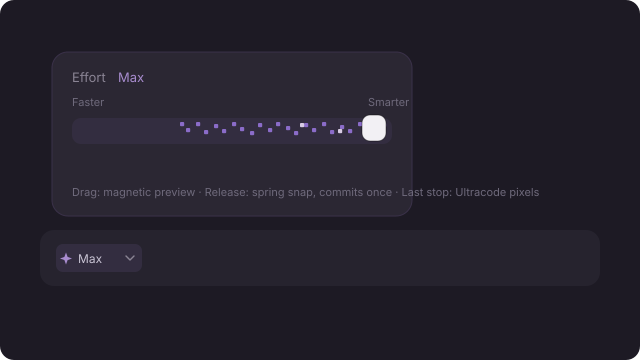

An unofficial, independent plugin inspired by the Claude Code Desktop effort
picker. Not affiliated with or endorsed by Anthropic or DeepSeek. Contains no
official code or assets; the interface and animation are drawn at runtime by
this package.

## What it does

Replaces the 「推理等级 ›」 ROW of DSH's native model menu with a Claude-style
slider, in place. The native `Model · Effort` pill and the 「模型 ›」 row stay
as they are.

- Open the native pill → the 「模型 ›」 row is unchanged; clicking it drills
  into the native model list (groups, search, check mark) as before, and
  backing out returns to the root menu. Where the 「推理等级 ›」 row used to
  be, the **slider track** is already there — no drill-in step, and no
  separate "Effort" title row.
- The current level shows right of the model name in the 「模型」 row, as
  `GLM-5.4 · Max`, matching the composer pill; the name cross-fades when the
  level changes.
- The track is a pill-shaped solid-fill bar (blue fill, white thumb, stop
  dots). The injector widens the native card to a 300px minimum and the
  slider fills the card's content box, so the track always matches the inner
  width exactly — no overflow, no clipping.
- **Releasing keeps the menu open; leaving it closes it.** The native menu
  closes on any document `mousedown` it cannot attribute to its own refs, and
  it does not recognise the slider (a separate React root inside the card).
  The plugin stops pointer events in the bubble phase at its host, so a
  press on the slider never reaches that listener while clicks elsewhere
  still do. Blur-to-close is implemented by the plugin: when focus leaves the
  slider toward something outside the card, it hands the card an Escape, so
  the native close path runs.
- Stops are the selected model's real reasoning-effort levels from the shared
  catalog (`ctx.modelDirectories`).
- Dragging previews magnetically; releasing snaps with a spring and commits
  once through `directory.select`, the same call the native submenu used, so
  the value reaches the request exactly as before.
- Two-way sync: the slider reads the session's durable model selection, so
  `/model` and the slider always agree, and the pill's `· Effort` caption
  follows the slider.
- **Every stop above Off has its own particle field**, all drawn by the same
  frozen `drawPixelField` and recoloured in CSS: **Default (Auto)** shows a
  rainbow to the right of the thumb, **Low** a green field, **High** a blue
  one (`filter: hue-rotate(-38deg) saturate(1.15)`), and **Max** a violet
  field filling the whole track. Off has no field. Dark theme draws a dot
  grid, light theme a mosaic.
- **The rainbow tint lands on cells only.** The painter also lays a
  translucent wash under its grid, so the tint overlay carries two
  intersecting CSS masks: a cell-grid image generated from the painter's own
  geometry (gaps stay untinted), and a hard edge at the thumb (the field
  lives on the un-swept side). A `clip-path` bounds the layer and rounds the
  live edge.
- **Per-cell light/dark grain.** A pure hue times the muted particles would
  read as one flat band, so the alternation is encoded in the mask's alpha:
  70% a low-frequency sample (one value per 3×2 patch of cells, soft regions
  of light and dark) and 30% the painter's own per-cell position hash — in
  phase with the cells' inherent alpha, irregular, and free of any
  checkerboard or block pattern. The hash has no time term, so the pattern
  never flickers; the alpha band is kept narrow (light 0.50–0.90, dark
  0.58–0.90) so the field reads calm, not busy.
- **The hue flows.** The band scrolls one full cycle every 6s, seamlessly;
  opening the menu shows the field already settled, and switching stops
  replays a 0.8s reveal sweep. `prefers-reduced-motion` freezes the scroll
  and the sweeps.
- **The level text takes the field colour** — the badge in the card and the
  effort word in the composer pill alike (violet `#7a5fc0`, blue, green, a
  violet for rainbow; caption grey on Off). Max is also bold, and both words
  come from the same sources as the native UI, so card and pill can never
  drift apart.
- **Per-model memory.** The level you last picked on a model is remembered
  (in `localStorage`), and picking another model restores this one's level
  through the same `directory.select` path — no need to open the menu.
  Picking a model inside the menu returns to the root pane (the slider card)
  instead of closing it.
- **Dragging is DOM-first.** While dragging or springing, the fill width is
  written straight to the track's `--ces-progress` CSS variable and the
  range's own value; React re-renders only when the rounded stop index
  changes (what the badge and the field depend on), so the thumb tracks the
  pointer without per-event reconciliation cost.
- **No flicker on stop arrival.** When the spring settles, the position is
  held until the store echoes the new selection back, instead of dropping to
  the old committed index during the RPC round-trip.
- `←/→`, `Home`, `End` move stops; `Esc` closes the menu; `Tab` follows the
  native focus chain; `prefers-reduced-motion` disables springs and the canvas.

Models without reasoning levels render no effort row, so no slider (native
rule); the pill hides in addressed subagent sessions.

## How the swap works (plugin-only, no DSH changes)

1. A renderless probe registered in the composer's session scope captures the
   same per-session directory face the native pill uses.
2. A `MutationObserver` on `document.body` finds the portaled menu card
   (`role="menu"`, direct child of body) and takes the **second `menuitem`
   row** by structure — never by locale text or hashed class names.
3. It inserts a host node **before** that row (a node React never created, so
   reconciliation leaves it alone), hides the row and drops its `role` so the
   native focus queries skip it, and mounts the slider with its own React root.
4. **Pane awareness**: drilling into the model list unmounts the native rows;
   the injector notices the host's next sibling is no longer the hidden row,
   unmounts the slider and removes the host. Backing out re-injects. The
   slider never lingers above the model list.
5. The observer drops mutations raised inside its own hosts and coalesces
   sweeps per animation frame, so the slider's own DOM churn never re-triggers
   it. When the menu closes the host leaves the document and the root unmounts.

## Stop mapping

Stops come from the model catalog, not a fixed list, laid out left to right
as **off → Default(Auto) → Low → High → Max** (`off` is identified by id, and
Auto — present only when the catalog declares no default — submits no
`reasoningEffort`, restoring the provider default); the remaining stops are
the catalog's levels in order, and each submits its own id.
